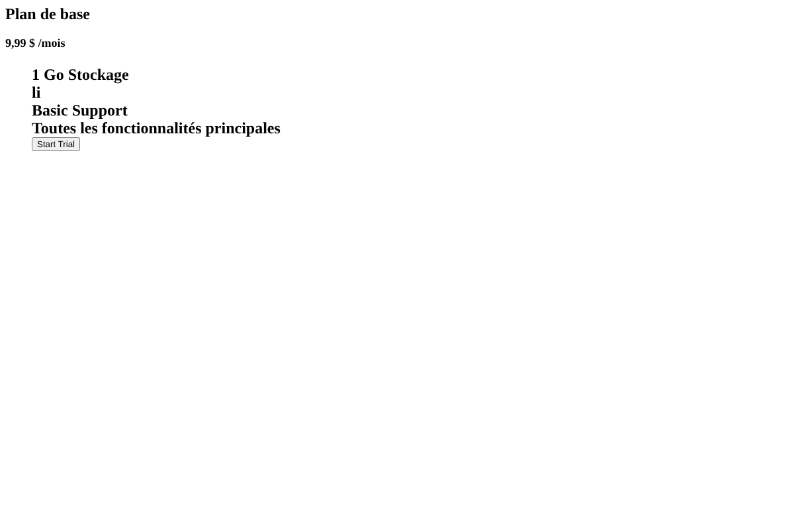
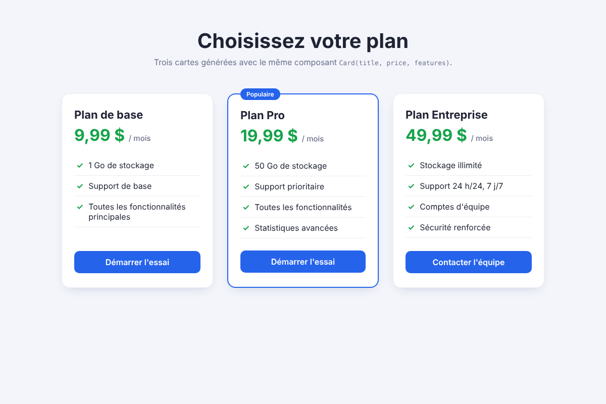

# Carte de prix : réparation et composant réutilisable (GOMYCODE)

## Fichiers
| Fichier | Rôle |
|---|---|
| `avant.html` | Code cassé d'origine (non modifié) |
| `corrige.html` | Même carte, bogues corrigés (étape 1) |
| `card.js` + `card.css` | Composant réutilisable `Card(title, price, features, options)` |
| `index.html` | Page de test : 3 plans générés avec le composant |
| `card.test.js` | Tests automatiques du composant (`npm install jsdom` puis `node card.test.js`) |
| `PROMPTS-IA.md` | Prompts IA utilisées |
| `capture-avant.png` / `capture-apres.png` | Rendu avant / après |

## Bogues trouvés et corrigés
**HTML**
1. `<! DOCTYPE html>` : espace interdit → `<!DOCTYPE html>`.
2. `<tête>` : balise traduite → `<head>` (le `</head>` ne correspondait à rien).
3. `<h2 class="title">Plan de base<h2>` : balise jamais fermée, ce qui ouvrait un 2ᵉ titre englobant tout le reste → `</h2>`.
4. `li<li>Basic Support</li>` : texte parasite « li » affiché dans la liste → supprimé.
5. `</ ul>` : espace dans la balise fermante → `</ul>`.
6. Pas de `lang`, `charset` ni `viewport` → ajoutés (accents corrects, affichage mobile).

**CSS**
7. Noms de classes différents entre le CSS et le HTML : `.prix` ≠ `pricing`, `.titre` ≠ `title`, `.présente` ≠ `features`. Aucun de ces styles ne s'appliquait.
8. Propriétés et valeurs traduites en français, donc ignorées par le navigateur : `Couleur de fond` → `background-color`, `Rembourrage` → `padding`, `Poids de la police : gras` → `font-weight: bold`, `Couleur : vert` → `color: green`, `Bordure en bas : 1px #eee solide` → `border-bottom: 1px solid #eee`, `Arrière-plan : bleu` → `background: blue`, `frontière : aucune` → `border: none`, `Marge-haut` → `margin-top`, `gauche` → `left`, `bleu foncé` → `darkblue`.
9. Faute de frappe : `Box-shdow` → `box-shadow`.
10. `.btn :survol` : espace + pseudo-classe traduite → `.btn:hover`.

**Bouton qui ne répond pas**
11. Aucun gestionnaire de clic et pas de `cursor: pointer` → ajout d'un `onclick` (version corrigée) puis d'un callback `onSelect` (composant), avec un retour visible (« Essai activé ✓ »).

## Remaniement en composant
```js
const carte = Card("Plan Pro", "19,99 $", ["50 Go", "Support prioritaire"], {
  featured: true,
  onSelect: (titre, bouton) => console.log("Choisi :", titre),
});
document.querySelector("#pricing").appendChild(carte);
```
- styles isolés en classes BEM + variables CSS (couleurs faciles à changer) ;
- `textContent` partout : pas d'injection HTML ;
- états `:hover`, `:focus-visible` et `:disabled` ; cartes de même hauteur dans la grille.

## Tests
- `node card.test.js` → **5 tests réussis** (titre/prix, liste, clic, option featured, sécurité HTML).
- `index.html` ouvert dans le navigateur : 3 cartes, clic → message « Essai gratuit démarré… », aucune erreur console.

## Avant / après
| Avant | Après |
|---|---|
|  |  |
