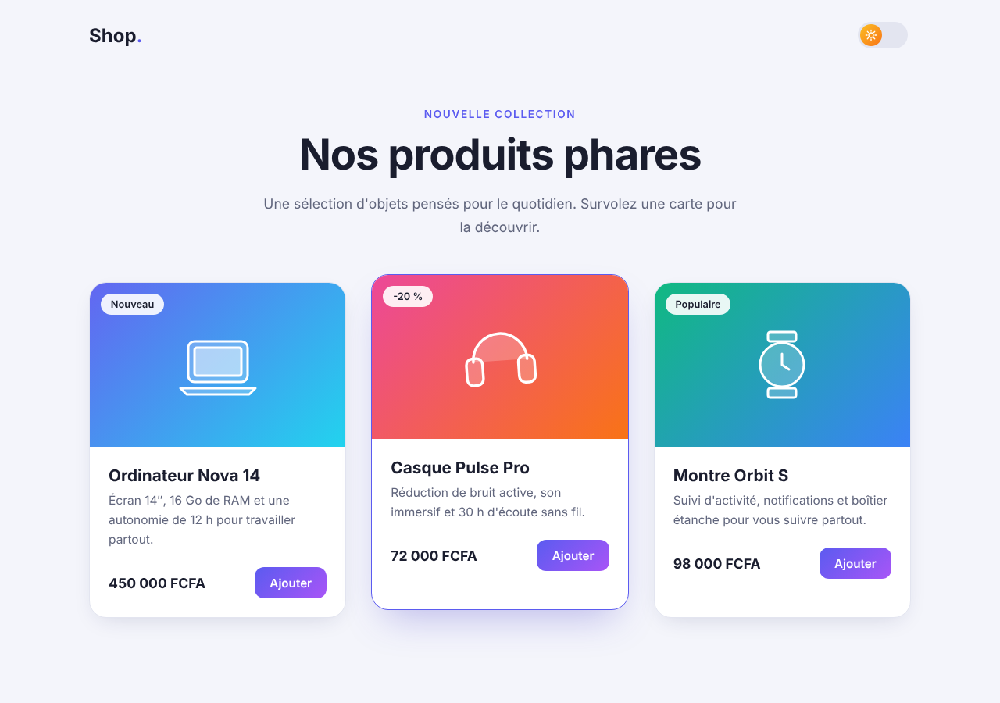
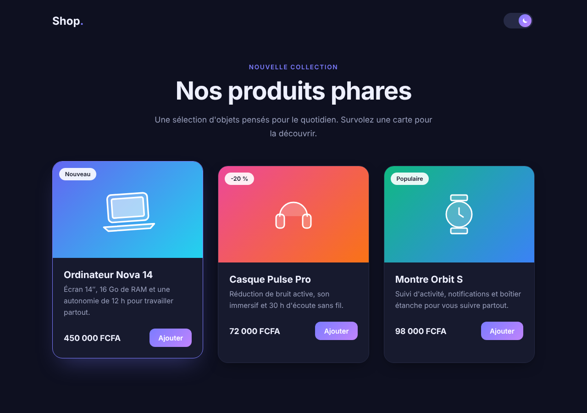

# Galerie de produits — clair / foncé (GOMYCODE)

Galerie de trois cartes produits avec effets de survol, bascule de thème clair/foncé et animations en fondu.
**HTML, CSS et JavaScript uniquement**, sans framework.

## Fonctionnalités
- **3 cartes produits** (ordinateur, casque, montre) avec illustrations SVG intégrées.
- **Effets de survol** : la carte se soulève, l'ombre et la bordure s'allument, l'icône zoome, un reflet lumineux traverse l'image et le bouton grossit.
- **Bascule clair/foncé** : interrupteur animé (soleil ↔ lune). Le thème choisi est **mémorisé** (`localStorage`) et suit le réglage du système à la première visite.
- **Animations en fondu** : les éléments apparaissent un par un au défilement (`IntersectionObserver`).
- **Bouton « Ajouter »** : petite notification « ajouté au panier ».

## Améliorations apportées après le premier jet de l'IA
- pas de flash de la mauvaise couleur au chargement (le thème est appliqué dans le `<head>`) ;
- effets de survol aussi au clavier (`tabindex` + `:focus-visible`) ;
- `aria-pressed` et `aria-label` dynamiques sur l'interrupteur ;
- respect de `prefers-reduced-motion` (animations coupées si l'utilisateur le demande) ;
- délai de fondu retiré après l'apparition, pour que le survol réagisse tout de suite.

## Lancer le projet
Ouvrir `index.html` dans le navigateur, ou utiliser l'extension **Live Server** de VS Code.

## Captures
| Mode clair | Mode foncé |
|---|---|
|  |  |
