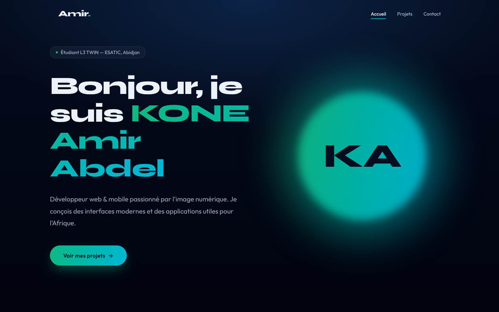

# Landing page — Checkpoint Lovable (GOMYCODE)

Page d'atterrissage en une seule section (hero) générée avec **Lovable**, puis personnalisée et retouchée à la main dans VS Code.

## Étapes réalisées
1. **Génération avec Lovable** : section hero avec mon nom (KONE Amir Abdel), un sous-titre et un bouton « Voir mes projets ».
2. **Personnalisation dans Lovable** : thème de couleurs émeraude → cyan sur fond bleu nuit, texte aligné à gauche sur desktop avec un cercle décoratif « KA » à droite (centré sur mobile).
3. **Export** du résultat en HTML (`lovable-export.html`) et ouverture dans VS Code.
4. **Améliorations manuelles** (`index.html`, bloc `AMÉLIORATIONS MANUELLES` dans le `<style>`) :
   - police du texte changée : Manrope → **Outfit** ;
   - espacement augmenté entre le titre, le sous-titre et le bouton (bouton plus large) ;
   - lien « Accueil » de la navigation souligné en dégradé.

## Fichiers
| Fichier | Rôle |
|---|---|
| `index.html` | Version finale (export Lovable + améliorations manuelles) |
| `lovable-export.html` | Export brut de Lovable, avant retouche |
| `capture-finale.png` | Capture d'écran de la version finale |
| `capture-lovable-avant-retouche.png` | Capture avant retouche |

